

  

<h1 align="center">TrueRenderer</h1>

  <strong>Your photographs. Your colour. Your way.</strong> 
  RAW development, colour tools and editable layers for macOS and Windows.

  <a href="#downloads">Download</a> &nbsp;·&nbsp;
  <a href="https://github.com/antoniodicoratoinfodev/TrueRenderer-releases/releases/tag/v0.2.7-macos.20261115">Release notes</a> &nbsp;·&nbsp;
  <a href="mailto:truerenderer@gmail.com">Support</a>

---

## Account and beta access

**Discover TrueRenderer in beta.** Request access at **[truerenderer@gmail.com](mailto:truerenderer@gmail.com)** and explore a workspace built around your photographs. An account is required; beta access details are provided by the publisher.

## Downloads

<!-- macos-download:start -->

| Platform | Download | Version |
|---|---|---|
| **macOS · Apple Silicon** | **[Download for Mac — Installer PKG · 62 MB](https://github.com/antoniodicoratoinfodev/TrueRenderer-releases/releases/download/v0.2.7-macos.20261115/TrueRenderer-0.2.7-macos.20261115-arm64.pkg)** | 0.2.7 · Beta |
| **Windows · x64** | **[Download for Windows — EXE](https://github.com/antoniodicoratoinfodev/TrueRenderer-releases/releases/download/v0.2.6.2-windows.20261113/TrueRenderer-0.2.6.2-Setup-x64.exe)** | 0.2.6.2 · Beta |

<!-- macos-download:end -->

**Mac:** open the PKG installer, follow the installation steps, then launch **TrueRenderer** from **Applications**. Quit the app before updating; your personal library and backups are retained. Apple Silicon beta: unsigned installer, ad-hoc signed app, not notarized.

**Windows:** run the offline installer. Windows 10/11 x64 with a compatible graphics device/driver; this beta is unsigned. Updates retain your catalog, settings and backups.

[Mac checksum](https://github.com/antoniodicoratoinfodev/TrueRenderer-releases/releases/download/v0.2.7-macos.20261115/SHA256SUMS.txt) · [Windows checksum](https://github.com/antoniodicoratoinfodev/TrueRenderer-releases/releases/download/v0.2.6.2-windows.20261113/TrueRenderer-0.2.6.2-Setup-x64.exe.sha256) · [All releases](https://github.com/antoniodicoratoinfodev/TrueRenderer-releases/releases)

The beta works offline. Sign in with the account provided for beta access.

---

## Explore the workspace

**Gallery preview:** these screenshots show macOS development build 0.2.9.1. The downloadable betas above are earlier versions; some illustrated features are awaiting a future installer update.

Develop RAW photographs, shape colour and refine local details in one desktop workspace. Keep your originals untouched, your adjustments editable and your library on your computer.

**[Explore the beta and downloads](https://github.com/antoniodicoratoinfodev/TrueRenderer-releases)** · **[Request beta access](mailto:truerenderer@gmail.com)**

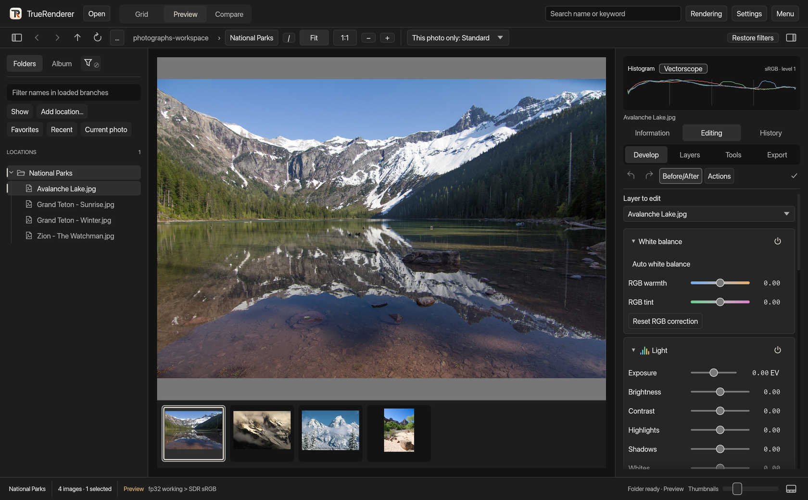

*Actual macOS 0.2.9.1 interface. Avalanche Lake shown in Before view; no retouch strokes applied. Photographs: NPS / David Restivo and National Park Service; [photograph sources and credits](https://github.com/antoniodicoratoinfodev/TrueRenderer-releases/blob/1819af3e1da9c6f5615c5d4ba20effa26ae7532e/docs/NOTICE.md).*

## From your first selection to your final image

| Your workflow | What you can do |
| --- | --- |
| Find your photographs | Browse folders, grid, detailed list and filmstrip; search filenames and keywords; filter stars, rejects and colour labels. |
| Build a collection | Manual and smart albums, virtual copies, version stacks, manual stacks and custom album ordering. |
| Make a selection | Synchronized comparison, side-by-side and wipe views, fixed colour samples, zoom and pan. |
| Develop your image | Photo profiles, white balance, exposure, tonal controls, RGB curves, saturation, vibrance, crop, geometry, manual optics and detail. |
| Shape your colour | Sixteen shared adjustment tools, sampled colour editing, selective colour, channel mixing and four-wheel grading. |
| Work locally | Editable layers, opacity, tonal fade, shadow/highlight blending and brush, gradient, radial, luminance and colour masks. |
| Retouch and compose | Paint, erase, clone, heal, transform and select; raster composition and editable `.truerenderer` projects. |
| Revisit your decisions | Undo/Redo, history, Before/After, reusable looks and selective copying of adjustments, layers and retouch strokes. |
| Deliver your work | JPEG, PNG and TIFF, destination colour profiles, output dimensions and DPI/PPI; DNG mosaic export for supported RAW sources. |
| Make it yours | English/Italian, themes, four tab styles, saved workspaces, configurable shortcuts and interface scaling. |

Availability depends on platform, camera and recording mode. TrueRenderer is currently a beta; licence purchases and subscriptions are planned for the public version.

## A closer look at the tools

These are cropped screenshots of the actual controls. Selecting a tool for a screenshot does not apply it to the photograph.

| Navigate | Move / transform |
| --- | --- |
|  |  |
| Pan and explore the photograph. | Position, scale, rotate and resize photo or layer content. |

| Brush | Eraser |
| --- | --- |
|  |  |
| Paint with adjustable radius, hardness, amount and colour. | Control transparency with adjustable brush settings. |

| Clone | Heal |
| --- | --- |
|  |  |
| Sample a source with Option/Alt-click and copy an area. | Repair an area using an adapted source sample. |

| Quick heal | Freehand selection |
| --- | --- |
| 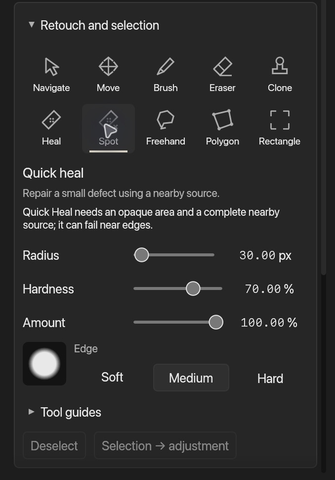 |  |
| Repair small defects using a nearby source. | Draw a selection, combine regions and feather its edge. |

| Polygonal selection | Rectangular selection |
| --- | --- |
| 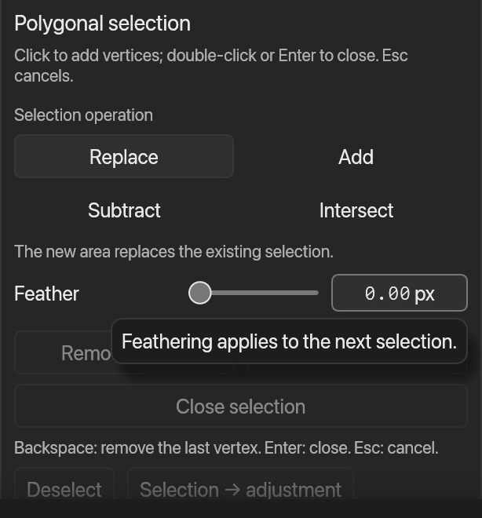 |  |
| Build a selection from vertices, with edge feathering. | Drag a rectangle; replace, add, subtract or intersect selections. |

## Develop, layers and export

| Develop | Layers | Export |
| --- | --- | --- |
|  |  | 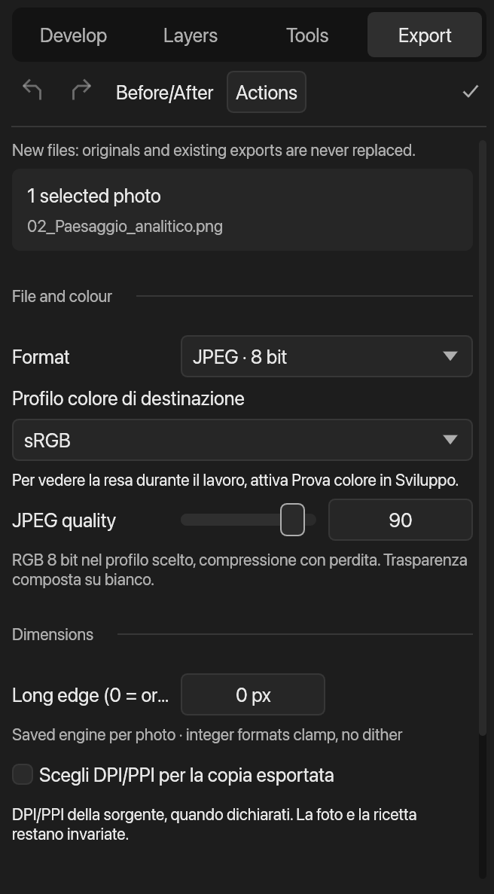 |
| Start with a photo profile and refine light and colour. | Add independent adjustments and control where they apply. | Choose output format, colour profile and image size. |

## Sixteen ways to shape light and colour

| Color editor | Local light and color |
| --- | --- |
|  |  |
| Sample a colour range; refine hue, saturation and luminance with Basic, Advanced and Uniformity controls. | Exposure, warmth, tint and saturation. |

| RGB point curves | Tonal levels |
| --- | --- |
|  |  |
| Composite RGB and independent red, green and blue curves. | Black and white points, gamma and output range. |

| Mixer and monochrome | Channel mixer |
| --- | --- |
| 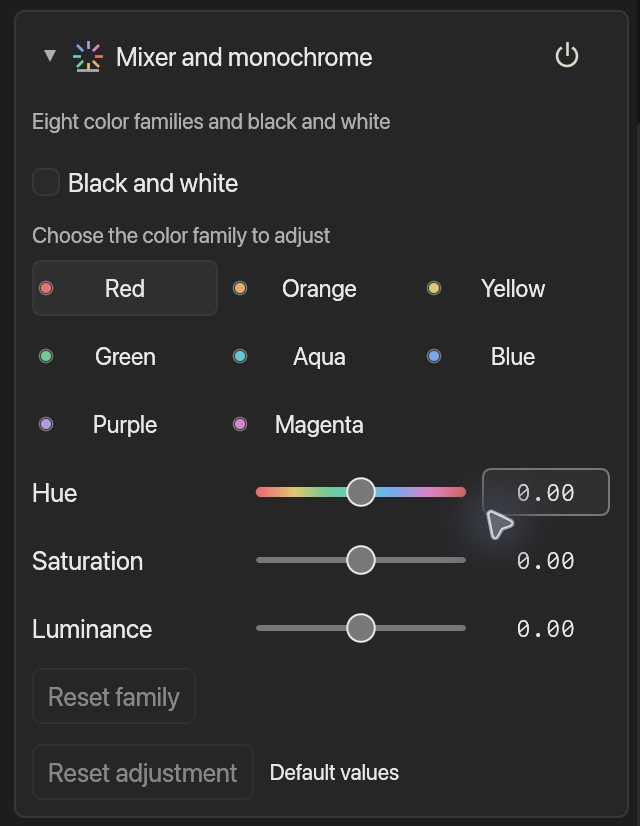 |  |
| Hue, saturation and luminance across eight colour families. | RGB channel contributions and per-channel offset. |

| Four-wheel grading | Black and white mixer |
| --- | --- |
|  |  |
| Separate shadows, midtones, highlights and global colour, with balance. | Monochrome conversion with eight colour brightness controls. |

| Color filter | Gradient map |
| --- | --- |
|  |  |
| Tint and density, with optional luminance preservation. | Map luminance to an editable colour palette. |

| Selective color | Colorize |
| --- | --- |
|  |  |
| C/M/Y/K controls in nine colour families; relative or absolute. | A common hue with separate chroma and brightness. |

| Tonal controls | Exposure, offset and gamma |
| --- | --- |
|  |  |
| Layer exposure, brightness, contrast, shadows, highlights, blacks and whites. | Gain, offset and power controls for RGB. |

| Luminance curve | Parametric curves |
| --- | --- |
|  | 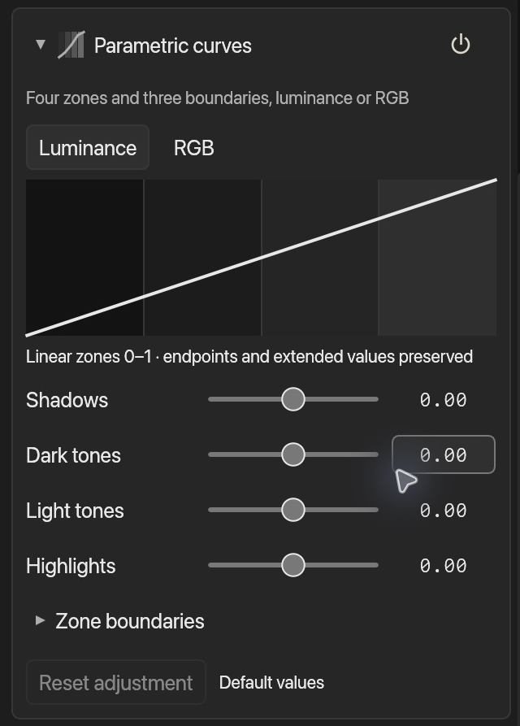 |
| A point curve on luminance, preserving colour differences. | Four tonal zones and three boundaries, in luminance or RGB. |

Color editor: range and Before/After colour samples

## Layers that follow your subject

| Layer blending | Brush mask |
| --- | --- |
|  | 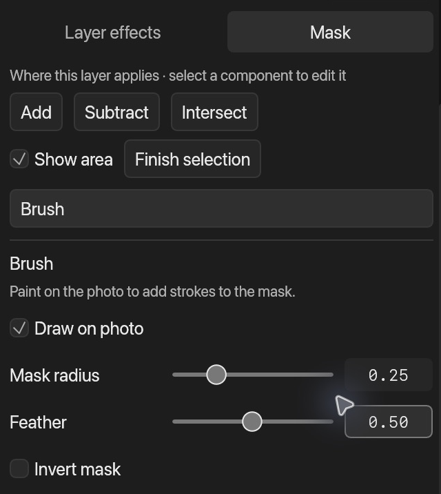 |
| Opacity, tonal fade and separate shadow/highlight blending control how a layer contributes. | Paint the area where an adjustment applies; control radius and feathering. |

| Gradient mask | Radial mask |
| --- | --- |
| 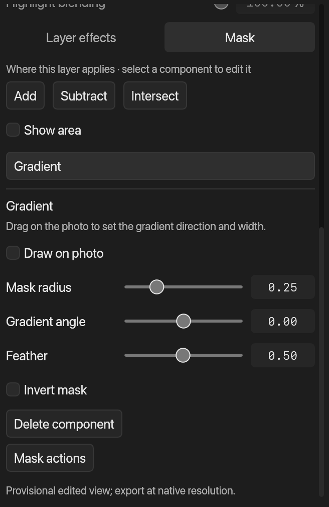 | 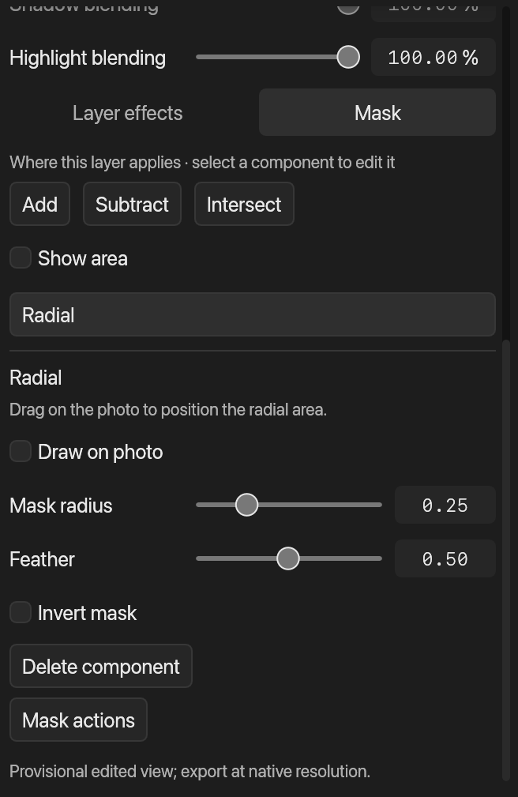 |
| Build a smooth transition with adjustable direction and width. | Isolate an elliptical area with a soft edge. |

| Luminance mask | Colour mask |
| --- | --- |
|  | 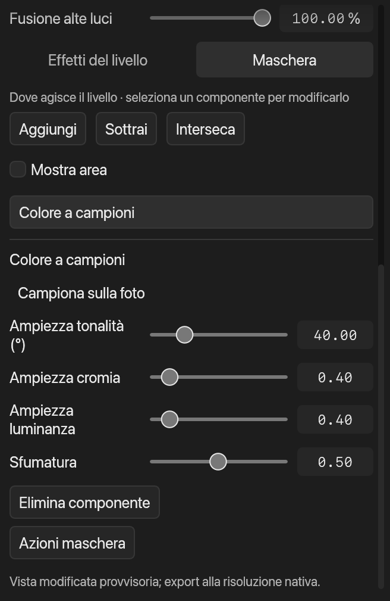 |
| Target a brightness range, with feathering and inversion. | Sample hue, chroma and luminance ranges. |

## Organize, compare and revisit

| Photo browser | Compare |
| --- | --- |
|  |  |
| Browse the grid and filmstrip, search and select photographs. Albums and smart albums organize references without moving originals. | Side-by-side and wipe comparisons, synchronized navigation and colour samplers. |

| Information and ratings | Editable history |
| --- | --- |
|  |  |
| Read capture metadata; assign stars, colour labels and keywords. | Revisit saved states and Undo/Redo your adjustments. |

| Preview and RAW settings |
| --- |
| 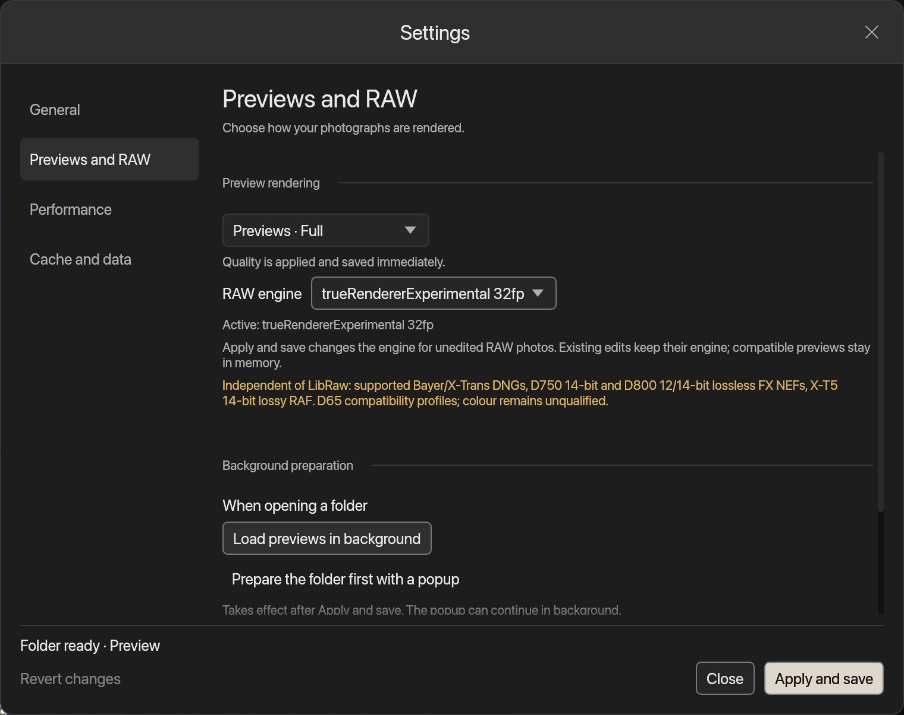 |
| Choose rendering quality and the RAW engine appropriate to your camera. |

## Rights and credits

TrueRenderer is proprietary software, available with the owner's permission under its [license](https://github.com/antoniodicoratoinfodev/TrueRenderer-releases/blob/1819af3e1da9c6f5615c5d4ba20effa26ae7532e/docs/LICENSE). See [third-party notices and photograph credits](https://github.com/antoniodicoratoinfodev/TrueRenderer-releases/blob/1819af3e1da9c6f5615c5d4ba20effa26ae7532e/docs/NOTICE.md).
