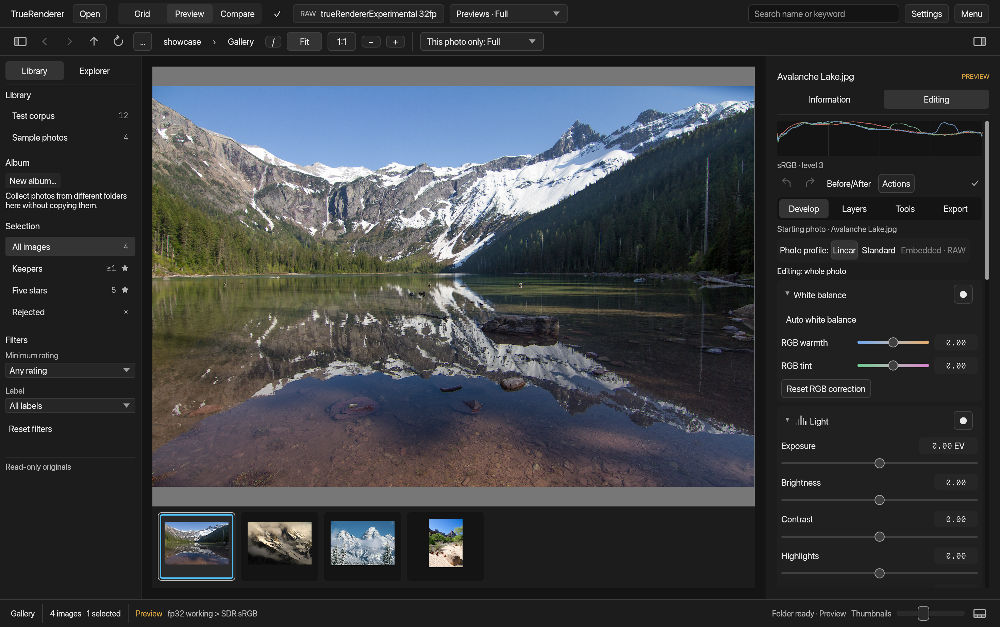
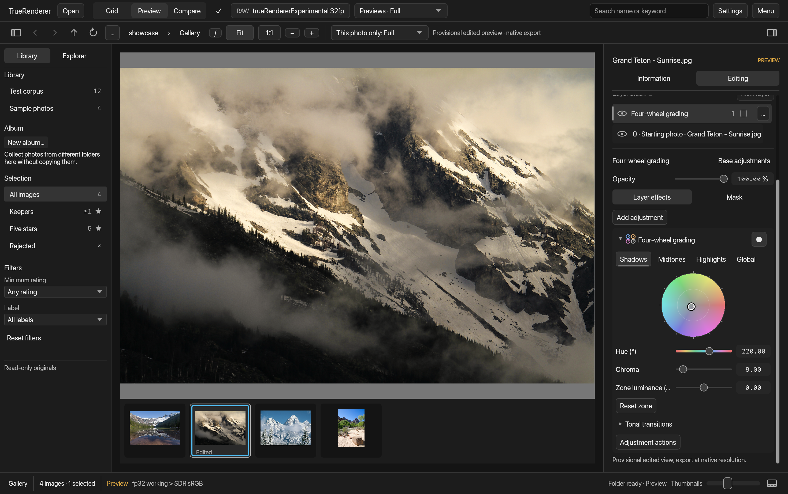
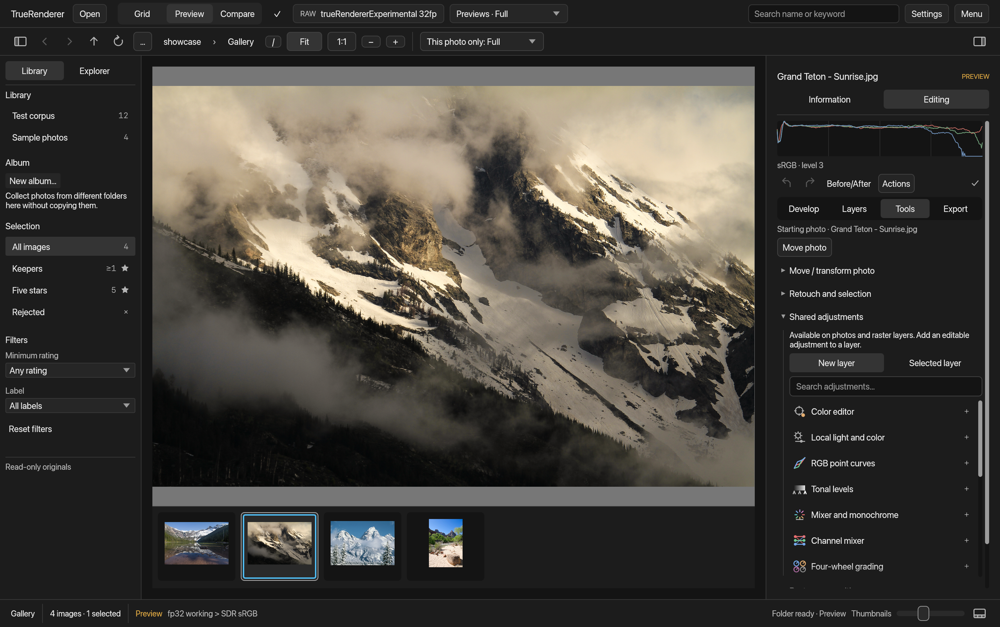
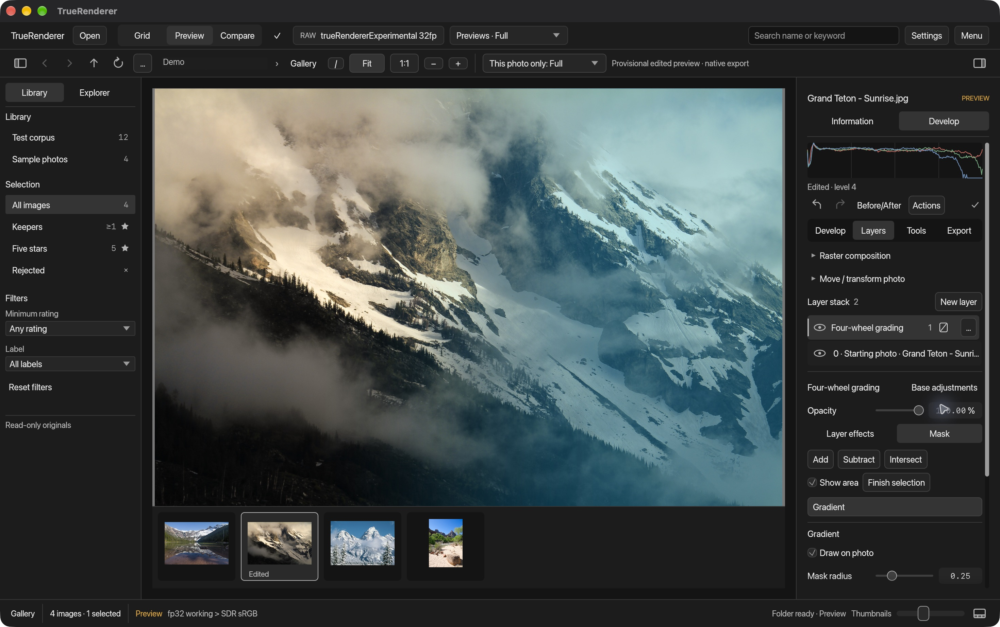
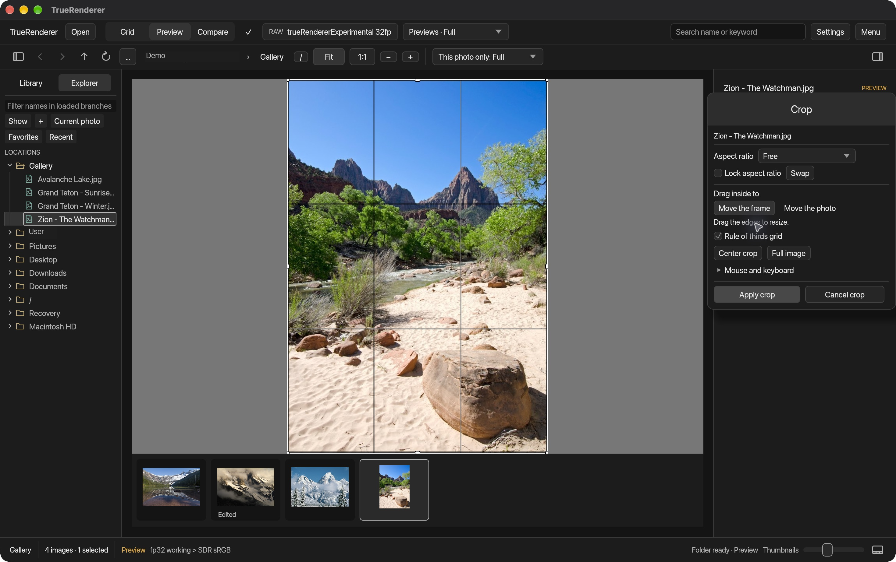
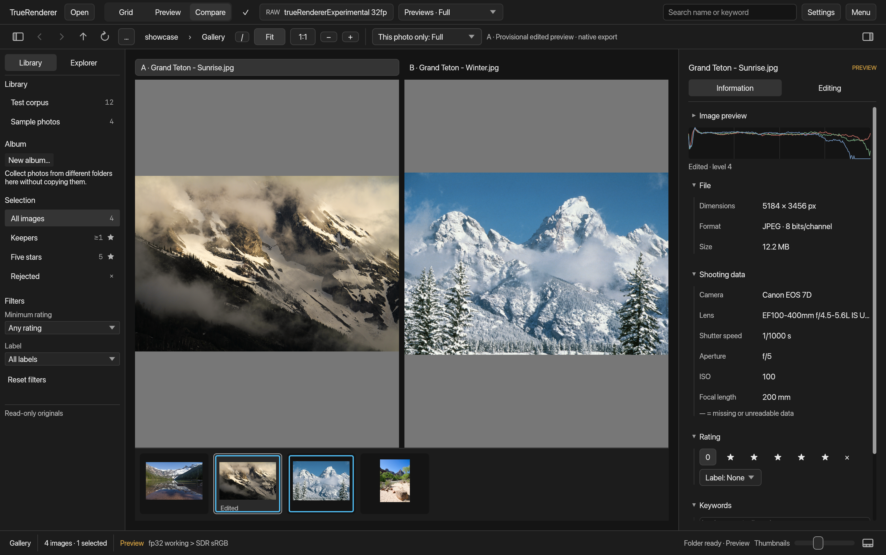
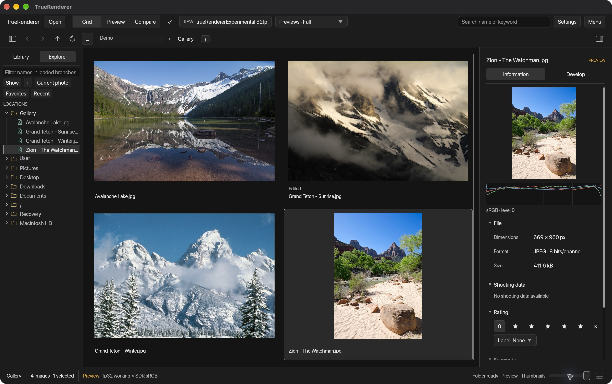

  

<h1 align="center">TrueRenderer</h1>

  <strong>Your photographs. Your colour. Your way.</strong> 
  RAW development, colour tools and editable layers for macOS and Windows.

  <a href="#downloads">Download</a> &nbsp;·&nbsp;
  <a href="https://github.com/antoniodicoratoinfodev/TrueRenderer-releases/releases/tag/v0.2.1-macos.20261105.refresh2">Release notes</a> &nbsp;·&nbsp;
  <a href="mailto:truerenderer@gmail.com">Support</a>

---

## Account and beta access

**Discover TrueRenderer in beta.** Request access at **[truerenderer@gmail.com](mailto:truerenderer@gmail.com)** and explore a workspace built around your photographs. An account is required; the current beta uses a shared offline demo account. Personal online accounts, licence purchases and subscriptions will become available with the public version.

## Downloads

<!-- macos-download:start -->

| Platform | Download | Version |
|---|---|---|
| **macOS · Apple Silicon** | **[Download for Mac — ZIP · 60 MB](https://github.com/antoniodicoratoinfodev/TrueRenderer-releases/releases/download/v0.2.1-macos.20261105.refresh2/TrueRenderer-0.2.1-macos.20261105.refresh2-arm64.zip)** | 0.2.1 · Beta |
| **Windows · x64** | **[Download for Windows — EXE](https://github.com/antoniodicoratoinfodev/TrueRenderer-releases/releases/download/v0.2.1-windows.20261105/TrueRenderer-0.2.1-Setup-x64.exe)** | 0.2.1 · Beta |

<!-- macos-download:end -->

**Mac:** extract the ZIP, keep the folder together and run **Avvia TrueRenderer.command**. Apple Silicon beta, ad-hoc signed and not notarized.

**Windows:** run the offline installer. Windows 10/11 x64 with a compatible graphics device/driver; this beta is unsigned. Updates retain your catalog, settings and backups.

[Mac checksum](https://github.com/antoniodicoratoinfodev/TrueRenderer-releases/releases/download/v0.2.1-macos.20261105.refresh2/SHA256SUMS.txt) · [Windows checksum](https://github.com/antoniodicoratoinfodev/TrueRenderer-releases/releases/download/v0.2.1-windows.20261105/TrueRenderer-0.2.1-Setup-x64.exe.sha256) · [All releases](https://github.com/antoniodicoratoinfodev/TrueRenderer-releases/releases)

Sign in with the account provided for beta access. The beta works offline; optional remembered credentials use your system's secure credential store.

---

## A workspace for your photographs

RAW development, expressive colour tools and photographic layers in one desktop workspace. TrueRenderer takes you from choosing your best frames to shaping the final image, with your originals untouched and your work stored locally.

Bring out the light you remember. Give a series its own colour palette. Refine one part of a photograph without changing the rest. Compare your decisions as you work, then export at the size and precision you need.

**Your photographs stay local; no photo upload is required.**

## Shape the light. Make the colour yours.

Start with the essentials: exposure, contrast, highlights, shadows and white balance. Go further with editable curves, sampled colour corrections and four-wheel grading for shadows, midtones, highlights and the whole image.

Natural white balance starts with a neutral point in the scene. Adjustable sampling helps you balance RAW colour with precision.

TrueRenderer works in **linear Rec.2020 floating point**, giving its photographic adjustments a wide numerical range. Histograms, tonal-level sampling and pixel inspection help you connect what you see with the image data.

| Make the image your own | Tools to get there |
|---|---|
| Balance light | Exposure, brightness, contrast, highlights, shadows, whites, blacks and automatic exposure |
| Set the white balance | RAW Temperature and Tint, As shot, automatic balance and neutral-area sampling |
| Sculpt the tones | Point curves, individual RGB curves, luminance and parametric curves; tonal levels with histograms and black, grey and white samplers |
| Refine individual colours | Saturation, vibrance, eight-band HSL, sampled colour and uniformity controls; selective colour and channel mixing |
| Create a signature palette | Four-wheel grading, colorize, colour filters, gradient maps and black-and-white mixing |
| Bring out detail | Texture, clarity, dehaze, sharpening and luminance/chroma noise reduction |
| Refine the optics | Manual distortion, vignette, chromatic aberration and defringe controls |

The searchable **Tools** catalogue puts adjustments within reach, with visual controls and photographic guidance in English and Italian.

**Creative grain** adds a vintage finish, with monochrome or coloured texture and independent control over size, amount and opacity.

## Build the look, layer by layer

Keep different creative decisions independently editable. Photographic layers bring adjustments, masks and retouching together while preserving the original. Switch effects on and off without losing their settings.

Paint, Eraser, Clone, Heal and Quick heal help refine individual areas. A shared Tools catalogue keeps colour adjustments, retouching and selections close at hand.

### Continue into raster editing

Take a developed photograph into a separate **`.truerenderer` project**, or start with a blank canvas. Combine independent images, pixel layers, adjustments and masks in the same workspace. Projects embed their images and retain editable layers; saving the project remains separate from exporting the finished image.

Photo-based compositions keep the original dimensions and resolution. A saved reference lets you return to the original photograph for further RAW development. Raster conversion embeds the developed image as pixels; RAW sensor settings remain with the original. Large projects and photo retouching are subject to memory and document limits.

- **Local adjustments:** combine brush, linear and radial gradients, luminance and hue masks; add, subtract, intersect, soften and invert their coverage.
- **Independent layer controls:** name, duplicate, reorder, hide or lock layers and adjust Opacity and Fill.
- **Reusable looks:** save selected layers, preview them on another photograph and choose their intensity, with optional masks.

**Experiment freely.** Undo, Redo, Reset all and Before/After keep decisions reversible. Reuse selected adjustments across photographs to give a series a consistent treatment.

Continuous sliders, precise numeric controls and colour guides make fine adjustments comfortable.

**Embedded previews** let you browse the camera rendering inside supported RAW files, up to 2048 pixels, including some cameras outside the independent engine's support. RAW edits remain preserved while you browse. On Windows, embedded previews also support RGB adjustments, crop and export. Camera previews retain the camera's rendering and do not replace full RAW development.

## Give every frame the right composition

Crop directly on the photograph with draggable edges, a rule-of-thirds grid and free, original, preset or custom aspect ratios. Lock the proportions, switch orientation, move the frame or move the photograph inside it. Keyboard controls help with fine adjustments.

Rotation, flips, straightening and perspective controls complete the composition tools. Masks follow the photograph through crop and rotation, and the original remains available for a different framing later.

## See the differences that matter

Choose between two frames with **side-by-side comparison and synchronized navigation**. Keep a comparison pair across folders, inspect detail at physical 1:1, and use Before/After to see how your adjustments shape the image.

Shutter speed, aperture, ISO, focal length and lens information sit alongside the image, helping you understand each frame as you select and develop it.

## Find your keepers. Keep them organized.

Browse folders in **Explorer**, review a thumbnail grid in **Library**, or stay with the photograph and its filmstrip. Favourites, navigation history, search and filters help you return to the images that matter.

Use **star ratings, colour labels, reject flags and keywords** to organize a shoot. Context menus bring ratings, comparison, adjustments, file navigation and export to the photograph you are working on.

Your originals remain read-only. Editing recipes, annotations and saved looks live in the local library and its backups.

## TrueRenderer RAW rendering

**TrueRenderer** is our independent RAW engine, available on macOS as **trueRendererExperimental 32fp**. Its 32-bit floating-point pipeline preserves negative values and values above nominal white. Independent decoding, directional reconstruction and sensor-aware highlight treatment give it a dedicated path from the sensor mosaic to the developed image.

TrueRenderer includes Temperature and Tint controls, neutral-area white-balance sampling, an As shot reset and DNG export of the decoded sensor mosaic. Its fp32 headroom is a concrete advantage; the best-looking rendering still depends on the photograph and the adjustments you choose.

### Camera compatibility

The following camera models and recording modes are currently supported by **TrueRenderer's independent engine**:

| Camera | RAW format | Supported recording modes |
|---|---|---|
| **Nikon D750** | NEF · Bayer | Full-frame FX, 14-bit lossless compressed RAW |
| **Nikon D800** | NEF · Bayer | Full-frame FX, 12-bit or 14-bit lossless compressed RAW |
| **Fujifilm X-T5** | RAF · X-Trans | Full-resolution, 14-bit lossy compressed RAW |

Supported Bayer and X-Trans **DNG files** can also use the independent engine. Compatibility depends on the file's compression and calibration features.

**Camera compatibility is expanding.** Request support for your camera at **[truerenderer@gmail.com](mailto:truerenderer@gmail.com)**, with its exact model and RAW recording mode. The developer will work to add requested support as soon as possible.

## Stay in the photographic flow

GPU acceleration for light and colour works alongside parallel CPU processing. Background preparation and disk caching help you move between photographs, while the last complete image stays visible as an update is calculated. Performance depends on your hardware, image size and active tools; some combinations use CPU processing.

Move between Fit and physical 1:1 detail, choose preview quality, and tailor CPU, GPU and memory preferences to your machine. English and Italian interfaces offer 100%, 150% and 200% scaling.

## Finish with the output you need

Prepare images for screen or print with **sRGB**, **Adobe RGB (1998)**, **Display P3**, **linear Rec.2020** or **CMYK with an output ICC**. Soft proofing previews the destination while you work, with extended linear Rec.2020 calculations at 32 bits.

Export photographs and raster compositions as **JPEG, PNG or TIFF16**, at native resolution or a chosen size and PPI. CMYK TIFF16 embeds your output profile; a printer-provided ICC matches the intended printing process. Floating-point TIFF preserves extended values in the photo workflow, while DNG export retains the decoded sensor mosaic.

For scientific imagery, TrueRenderer also opens **2D FITS images**, with linear or asinh display, a histogram and native-value inspection.

## Try it with the included photographs

Four public-domain landscapes are included in **Library**, under **Sample photos**, including in the macOS bundle for offline use. Start there to explore the workspace. Photograph credits are included in [NOTICE.md](https://github.com/antoniodicoratoinfodev/TrueRenderer-releases/blob/1819af3e1da9c6f5615c5d4ba20effa26ae7532e/docs/NOTICE.md).

## Rights and credits

TrueRenderer is proprietary software. Access to this repository does not grant a general license to run or redistribute it; prior permission from the owner remains required under the unchanged [license](https://github.com/antoniodicoratoinfodev/TrueRenderer-releases/blob/1819af3e1da9c6f5615c5d4ba20effa26ae7532e/docs/LICENSE). See [third-party notices and photograph credits](https://github.com/antoniodicoratoinfodev/TrueRenderer-releases/blob/1819af3e1da9c6f5615c5d4ba20effa26ae7532e/docs/NOTICE.md).

