<h1 align="center">TrueRenderer</h1>

  

  <strong>Your photographs. Your colour. Your way.</strong> 
  RAW development, precision colour grading and layered retouching for macOS and Windows.

  <a href="#downloads"><strong>Download the beta</strong></a> &nbsp;·&nbsp;
  <a href="mailto:truerenderer@gmail.com"><strong>Request beta access</strong></a> &nbsp;·&nbsp;
  <a href="#workspace-themes">Workspace themes</a>

Take a photograph from the first selection to the final export. Adjustments stay editable, your originals stay intact, and your catalogue stays on your computer.

## Downloads

<!-- macos-download:start -->

| Platform | Download | Version |
|---|---|---|
| **macOS · Apple Silicon** | **[Download for Mac — Installer PKG · 63 MB](https://github.com/antoniodicoratoinfodev/TrueRenderer-releases/releases/download/v0.2.9.2-macos.20261119/TrueRenderer-0.2.9.2-macos.20261119-arm64.pkg)** | 0.2.9.2 · Beta |
| **Windows · x64** | **[Download for Windows — EXE](https://github.com/antoniodicoratoinfodev/TrueRenderer-releases/releases/download/v0.2.9.2-windows.20261119/TrueRenderer-0.2.9.2-Setup-x64.exe)** | 0.2.9.2 · Beta |

<!-- macos-download:end -->

**Try TrueRenderer in beta.** Request an account at [truerenderer@gmail.com](mailto:truerenderer@gmail.com), then sign in to edit offline.

Installation, release notes and checksums

On macOS, open the PKG installer and launch TrueRenderer from Applications. On Windows 10/11 x64, run the EXE installer and launch TrueRenderer from the Start menu. Quit TrueRenderer before installing an update. Check the release notes for installation details specific to your platform.

[Mac release notes](https://github.com/antoniodicoratoinfodev/TrueRenderer-releases/releases/tag/v0.2.9.2-macos.20261119) · [Windows release notes](https://github.com/antoniodicoratoinfodev/TrueRenderer-releases/releases/tag/v0.2.9.2-windows.20261119)

[Mac checksum](https://github.com/antoniodicoratoinfodev/TrueRenderer-releases/releases/download/v0.2.9.2-macos.20261119/SHA256SUMS.txt) · [Windows checksum](https://github.com/antoniodicoratoinfodev/TrueRenderer-releases/releases/download/v0.2.9.2-windows.20261119/TrueRenderer-0.2.9.2-Setup-x64.exe.sha256) · [All releases](https://github.com/antoniodicoratoinfodev/TrueRenderer-releases/releases)

## From RAW to finished photograph

- **Organise and compare.** Browse folders, rate and label photographs, build smart albums and explore alternate edits with virtual copies. Compare frames side by side or with a wipe.
- **Develop and grade.** Start with a photo profile and set white balance, exposure and detail. Shape your palette with the Color Editor’s eyedropper, RGB and luminance curves, selective colour, gradient maps and four-wheel grading. Save a look or copy selected adjustments to other photographs.
- **Refine with layers and masks.** Build editable adjustments with brush, linear gradient, radial, luminance and colour masks. Set layer opacity and control how an adjustment blends into shadows and highlights.
- **Retouch and compose.** Clean up detail with Clone, Heal and Quick Heal. Make freehand, polygonal or rectangular selections and build layered compositions in editable `.truerenderer` projects.
- **Export for screen or print.** Choose JPEG, PNG or TIFF, set the destination colour profile, and control output dimensions and resolution. Export a DNG mosaic from compatible RAW files.

### Retouching in the macOS beta

- **Liquify** reshapes fabric, silhouettes and fine contours with a brush. Paint a protection mask to keep surrounding details in place.
- **Mesh Warp** uses an editable grid with nodes and curve handles to refine shapes. Both warp tools can follow a selection and let you reopen an adjustment after applying it.
- **100% Before/After loupe** pins a detail such as a seam or an edge and shows both versions at pixel scale as you work.

## Explore the workspace

*Avalanche Lake, photographed by David Restivo for the National Park Service.*

### Develop and export

<a href="assets/readme-develop-overview.png">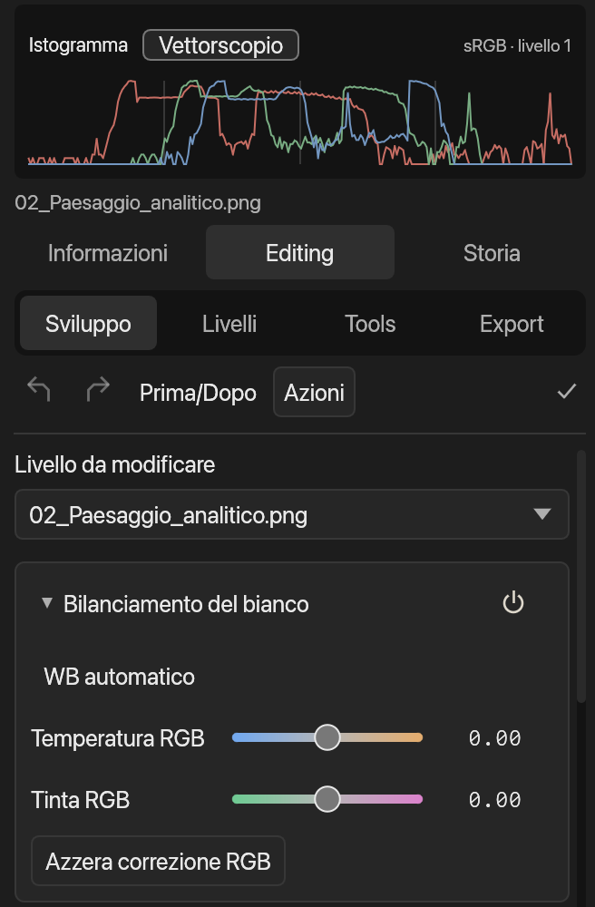</a>

#### Develop

Start with a photo profile, then balance white balance, exposure and the tonal range. The Light controls give separate access to brightness, contrast, highlights, shadows, whites and blacks.

#### Export

Choose JPEG, PNG or TIFF, a destination colour profile and the output size. Set quality and resolution where appropriate, then create a new output file while retaining the source.

### Retouching and selection tools

<a href="assets/readme-retouch-overview.png">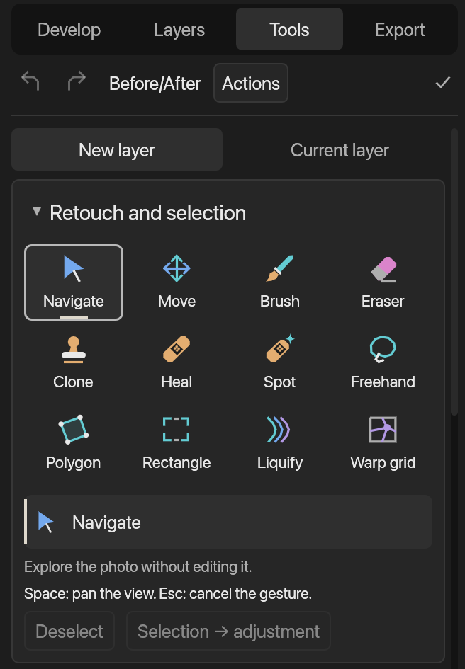</a>

#### Navigate

Use this tool to inspect the frame and move around the image before choosing a retouch or selection tool. Hold Space to pan the view.

#### Move / transform

Set horizontal and vertical position, rotation and scale for the photograph or selected layer. Hold Option/Alt while dragging a corner to preserve proportions.

<a href="assets/readme-transform-panel.png">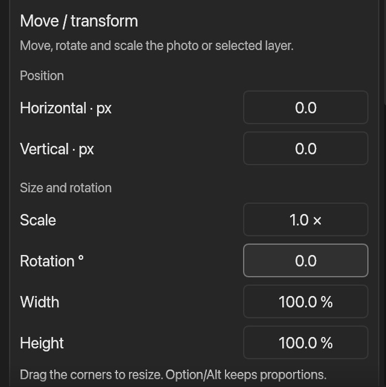</a>

#### Brush

Choose a colour and build a painted correction on the photo or selected layer. Radius sets the brush size, hardness shapes the edge and amount controls its strength.

#### Eraser

Remove content under the brush to reveal transparency. Adjust radius, hardness and amount for a broad soft transition or a more precise edge.

#### Clone

Option/Alt-click a source point, then paint where you want to copy that detail. Radius, hardness and amount help blend the copied area into its surroundings.

#### Heal

Option/Alt-click to choose a source, then paint over the area to repair. Healing adapts the sampled detail to the destination, helping small corrections sit naturally in the image.

#### Quick heal

Brush over small blemishes or dust spots and let Quick Heal use nearby image detail to blend the correction.

#### Freehand selection

Trace an irregular region directly on the photo. Replace, add, subtract or intersect regions, then feather the edge for a softer transition.

#### Polygonal selection

Place vertices around a subject with straight edges, then double-click or press Enter to close the outline. Combine it with an existing selection and set feathering before making the next selection.

#### Rectangular selection

Drag out a rectangular region for a quick, precise selection. Use replace, add, subtract or intersect to combine regions and feather the edge when needed.

### Light and colour adjustments

<a href="assets/readme-adjustments-overview.png">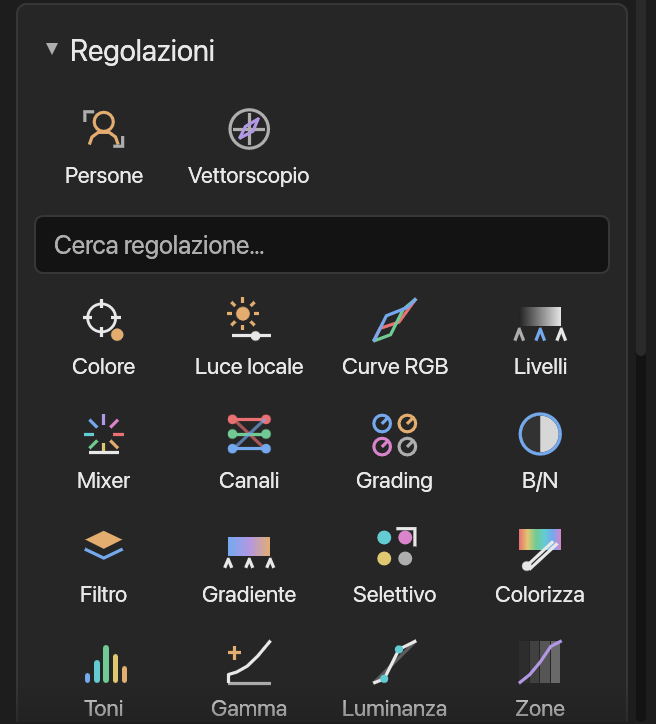</a>

#### Color editor

Sample a colour on the photograph and refine just that range. Basic, Advanced and Uniformity views help adjust hue, saturation and luminance, control the range and bring its colours closer together.

#### Local light and color

Balance a region with exposure, RGB warmth, tint and saturation in one adjustment. Pair it with a mask to work on a foreground, background or other selected area.

#### RGB point curves

Shape contrast and colour with a composite RGB curve or separate red, green and blue curves. Add points and refine their input/output coordinates to control particular parts of the tonal range.

<a href="assets/readme-curves-panel.png">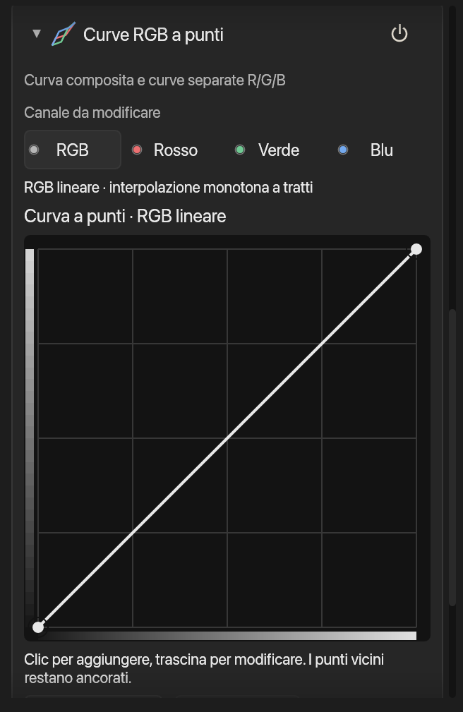</a>

#### Tonal levels

Set the input black point, white point and gamma, then refine the output range. Composite and individual channel controls let you balance the overall image or a specific channel.

#### Mixer and monochrome

Choose one of eight colour families and adjust its hue, saturation and luminance. Use it to refine a palette or explore a monochrome treatment with the black-and-white option.

#### Channel mixer

Control how the red, green and blue inputs contribute to each output channel. Per-channel offsets add another way to adjust colour balance and create deliberate colour treatments.

#### Four-wheel grading

Choose shadows, midtones, highlights or the global range, then set its hue, chroma and luminance. Tonal transitions control how the ranges meet for a more unified grade.

#### Black and white mixer

Convert the image to monochrome, then balance the brightness of eight original colour families. These controls help separate subjects that have similar brightness but different colours.

#### Color filter

Choose a filter hue and increase density to introduce a warm, cool or creative tint. Luminance preservation lets you retain brightness while changing the colour treatment.

#### Gradient map

Associate dark and bright tones with an editable palette. Add and edit colour stops, reverse the palette and use the amount control to blend the treatment into the photograph.

<a href="assets/readme-gradient_map-panel.png">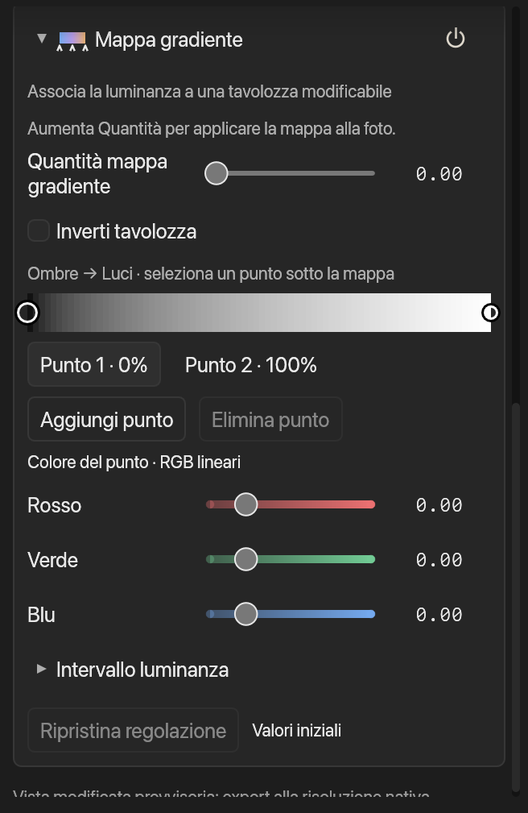</a>

#### Selective color

Choose one of nine colour families and refine its cyan, magenta, yellow and black components. Relative and absolute modes provide different responses for subtle palette changes or stronger colour treatments.

#### Colorize

Apply a common hue with separate chroma and brightness controls. Increase the amount to blend in the chosen colour and adjust the balance to suit the image.

#### Tonal controls

Refine exposure, brightness, contrast, shadows, highlights, blacks and whites on a layer. Mask the layer to give one part of the image its own tonal balance.

<a href="assets/readme-tonal-panel.png">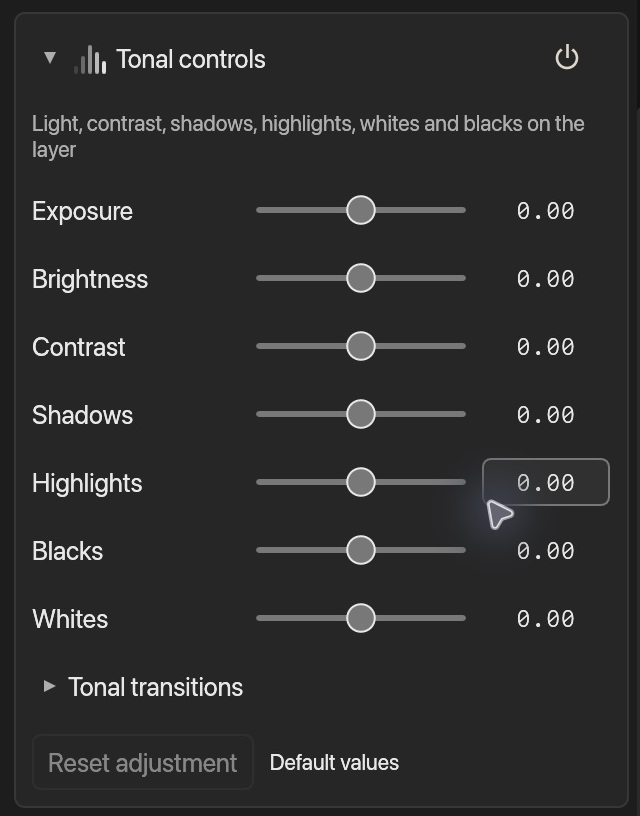</a>

#### Exposure, offset and gamma

Adjust signal gain, offset and gamma in a dedicated layer tool. The controls provide a direct way to shape brightness and tonal response with the order exposure, offset, then gamma.

#### Luminance curve

Shape light and contrast with a point curve on luminance while preserving colour differences. Place points to target selected brightness ranges and refine their coordinates numerically.

#### Parametric curves

Adjust four tonal zones and the three boundaries between them. Choose luminance or RGB to shape the response, then tune zone transitions for the contrast you want.

#### Colour range and Before/After samples

Refine the sampled range with feathering, hue, saturation and luminance controls. The Before/After swatches show the effect on the selected colour sample.

### Layers, blending and masks

<a href="assets/readme-layers-overview.png">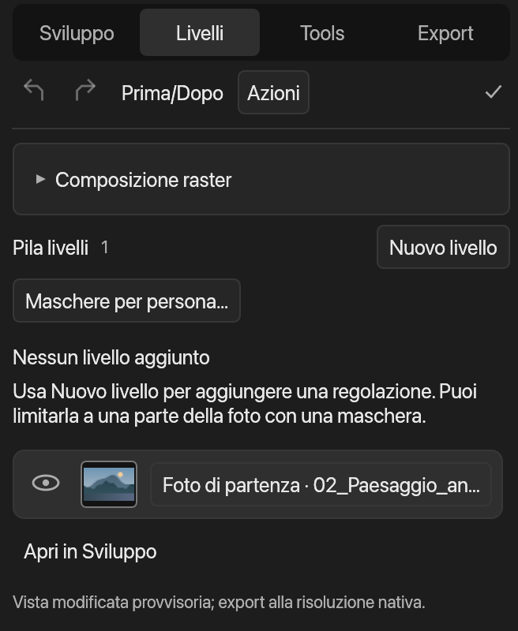</a>

#### Layers and blending

Keep adjustments in independently editable layers and add a mask to limit them to part of the photograph. Set overall opacity, then use tonal fade and separate shadow/highlight blending to control where the layer contributes by brightness. These tonal controls complement spatial masks for finer integration.

Combine mask components with Add, Subtract and Intersect to refine the area you want to adjust.

#### Brush mask

Paint the region where the selected layer should act. Adjust radius and feathering, invert the mask when useful, and combine components with Add, Subtract or Intersect.

#### Gradient mask

Drag on the photograph to set a gradual transition, then refine its angle, width and feathering. Use it to ease an adjustment across the frame, for example between sky and foreground.

#### Radial mask

Drag to position a soft elliptical region around the area you want to adjust. Refine the radius and feathering, or invert the mask to work on the surrounding area.

#### Luminance mask

Choose the start and end of a brightness range and soften its boundaries with feathering. This lets an adjustment follow the image’s tones across the photograph.

<a href="assets/readme-mask-luminance-panel.png">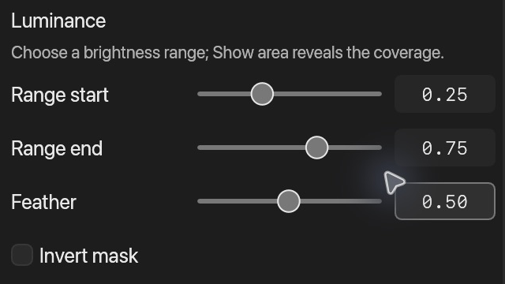</a>

#### Colour mask

Sample a colour on the photograph and control the hue, chroma and luminance widths of its range. Feather the transition and combine it with other mask components to refine the target area.

### Photo browser, comparison and history

<a href="assets/readme-library-overview.png">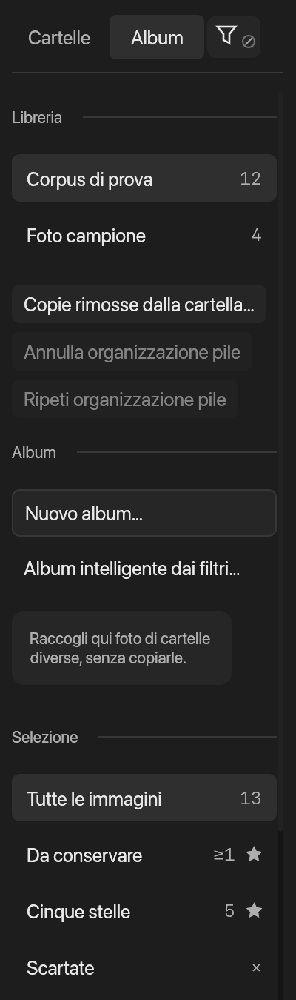</a>

#### Photo browser

Browse a shoot in the grid and filmstrip, search filenames and keywords, and narrow the selection with ratings and labels. Manual and smart albums collect references to photographs without moving the originals.

#### Compare

Place photographs side by side or use the wipe view to compare them. Synchronized navigation and colour samplers help you judge detail and colour while choosing a frame.

#### Information and ratings

Read image dimensions, format and available capture data alongside the photograph. Stars, colour labels and keywords help turn a folder of images into a useful selection.

#### Editable history

Return to a saved editing state or move forward again with Undo/Redo. The history keeps previous decisions accessible as you explore different versions of a photograph.

## Rights and credits

TrueRenderer is proprietary software, available with the owner's permission under its [license](https://github.com/antoniodicoratoinfodev/TrueRenderer-releases/blob/1819af3e1da9c6f5615c5d4ba20effa26ae7532e/docs/LICENSE). See [third-party notices and photograph credits](https://github.com/antoniodicoratoinfodev/TrueRenderer-releases/blob/1819af3e1da9c6f5615c5d4ba20effa26ae7532e/docs/NOTICE.md).

## Workspace themes

Personalise TrueRenderer with saved workspaces, configurable shortcuts, interface scaling, four tab styles and six themes. Standard, shown at the top, pairs graphite panels with ivory accents. The gallery shows the same photograph in the five other themes.

<table>
  <tr>
    <td align="center"> <strong>Black</strong></td>
    <td align="center"><a href="assets/readme-theme-black-soft.png">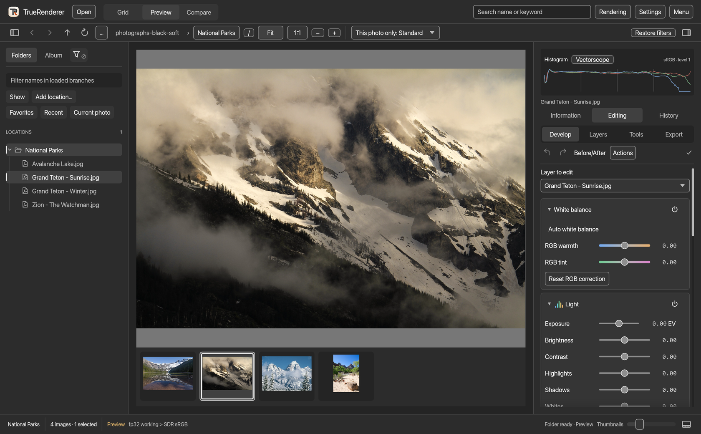</a> <strong>Soft black</strong></td>
  </tr>
  <tr>
    <td align="center"> <strong>Neutral gray</strong></td>
    <td align="center"><a href="assets/readme-theme-white-80.png">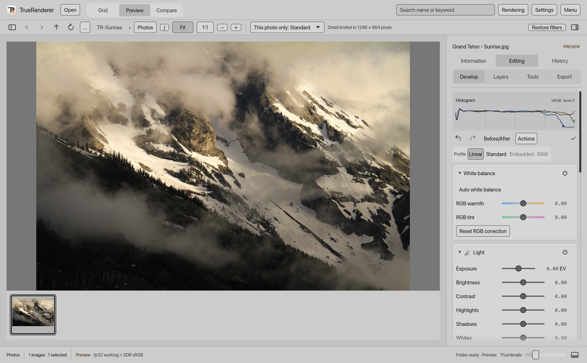</a> <strong>White 80%</strong></td>
  </tr>
  <tr>
    <td align="center" colspan="2"><a href="assets/readme-theme-white.png">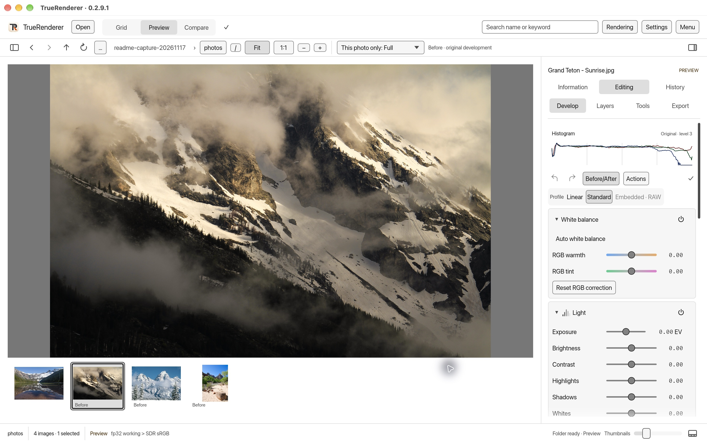</a> <strong>White</strong></td>
  </tr>
</table>

*Grand Teton – Sunrise, photographed by David Restivo for the National Park Service.* [Photograph credits](https://github.com/antoniodicoratoinfodev/TrueRenderer-releases/blob/1819af3e1da9c6f5615c5d4ba20effa26ae7532e/docs/NOTICE.md)
